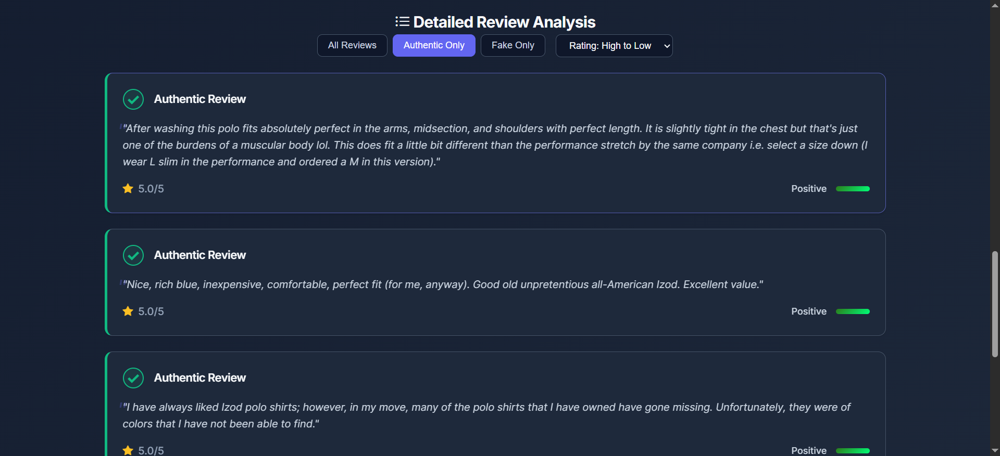
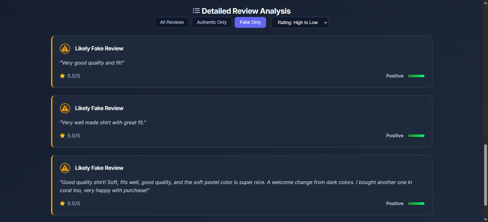
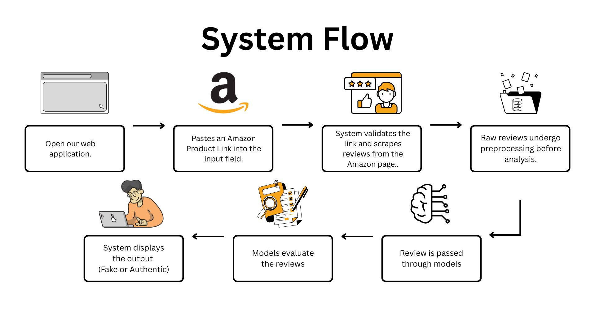
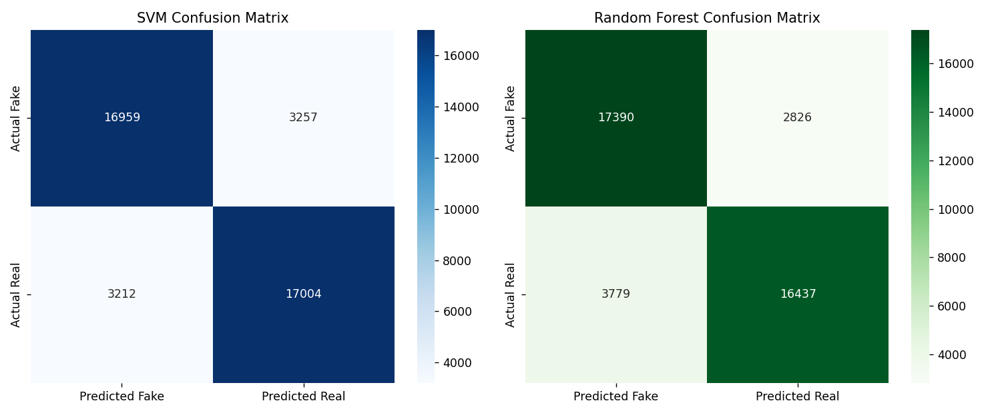

# ReviewGuard

**A machine learning-powered web application that detects fake reviews and analyzes sentiment using AI models.**

Paste a product URL, and ReviewGuard scrapes the reviews, classifies each one as genuine or fake with two models (SVM and Random Forest), analyzes its sentiment, and summarizes everything into charts and an overall product trust score.

Built as a Software Engineering course project at the Technological Institute of the Philippines (BS Computer Science, July 2025).

## Screenshots

**Reviews flagged as authentic**



**Reviews flagged as likely fake**



## Features

- **Dual-Model Analysis:** Choose between SVM and Random Forest
- **Real-time Web Scraping:** Automatically extracts reviews from product URLs
- **Sentiment Analysis:** Analyzes the emotional tone of reviews
- **Visual Analytics:** Interactive charts and detailed statistics
- **Trust Score:** Overall product trustworthiness based on authentic reviews

## How to use

1. **Start the application:**
   ```bash
   python app.py
   ```
2. **Open the web interface** at `http://localhost:5001`
   - Paste a product URL
   - Select your preferred model from the dropdown
   - Click "Analyze" to process the reviews
3. **View results:**
   - Summary statistics show the primary model's predictions
   - The model section displays results from each model
   - Individual review cards show detailed analysis
   - Interactive charts visualize the data

## How it works



```
Product URL
    │
    ▼
Scraper (requests + BeautifulSoup)  ──►  English-language reviews + ratings
    │
    ▼
Preprocessing (cleaning, tokenization, stop-word removal, lemmatization)
    │
    ▼
Features: Word2Vec embeddings (averaged) + star rating + review length
          + sentiment polarity and subjectivity
    │
    ▼
SVM / Random Forest  ──►  Real vs. Fake label
    │
    ▼
Flask API  ──►  Web UI (summary stats, review cards, Chart.js charts, trust score)
```

**Model settings:** Linear-kernel SVM (C = 1.0); Random Forest with 100 trees and max depth 10; Word2Vec with 100-dimensional vectors, window size 5. Split 80/20 train/test, stratified by class, random state 42.

## Tech stack

- **Backend:** Python, Flask
- **Machine learning:** scikit-learn, gensim (Word2Vec), pandas
- **Scraping:** requests, BeautifulSoup
- **Frontend:** HTML, CSS, JavaScript, Chart.js

## Installation

**Prerequisites:** Python 3.7 or higher and pip.

1. Clone the repository
   ```bash
   git clone https://github.com/frncsrys/ReviewGuard.git
   cd ReviewGuard
   ```
2. Install dependencies
   ```bash
   pip install -r requirements.txt
   ```
3. Run the application
   ```bash
   python app.py
   ```

## File structure

- `app.py` - Main Flask application
- `model.py` - Machine learning model
- `preprocessing.py` - Text preprocessing utilities
- `scraper.py` - Web scraping functionality
- `templates/` - HTML templates
- `static/` - CSS, JavaScript, and static assets
- `Data/` - Training data and model files

## Results

Trained on a dataset of **40,412 labeled reviews** (balanced between real and fake) across categories such as electronics, apparel, and home goods. Reviews are labeled "Real (Original)" or "Fake (Computer Generated)."

| Model | Accuracy | Precision | Recall | F1-score |
|---|---|---|---|---|
| **SVM** (linear kernel, deployed model) | **84.7%** | 0.85 | 0.85 | 0.85 |
| Random Forest (100 trees, max depth 10) | 83.7% | 0.84 | 0.84 | 0.84 |

The SVM was chosen for deployment because it balances catching fake reviews against wrongly flagging real ones. The Random Forest catches slightly more fakes (86.0% vs. 83.9% true positive rate) but flags more genuine reviews as fake (9.4% vs. 8.0% false positive rate).




